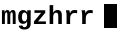
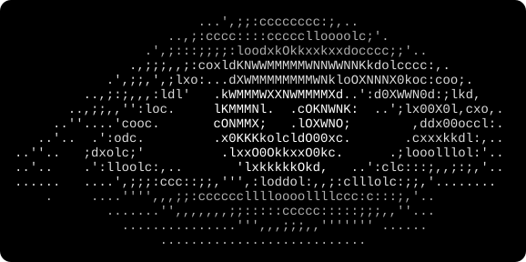

<picture>
  <source media="(prefers-color-scheme: dark)" srcset="assets/wordmark-dark.svg">
  
</picture>

  <samp>
    <a href="#top">Home</a> &nbsp;|&nbsp;
    <a href="#about-me">About</a> &nbsp;|&nbsp;
    <a href="https://github.com/mgzhrr?tab=repositories">Projects</a> &nbsp;|&nbsp;
    <a href="https://github.com/mgzhrr/PersonalPage">Blog</a> &nbsp;|&nbsp;
    <a href="#contact">Contact</a>
  </samp>

 

## About Me

<table>
  <tr>
    <td width="22%" valign="middle">
      <samp>
        Hi, I'm Max.
      </samp>
    </td>
    <td width="78%" align="center" valign="middle">
      <picture>
        <source media="(prefers-color-scheme: dark)" srcset="assets/eye-dark.svg">
        
      </picture>
    </td>
  </tr>
</table>

## Skills & Technologies

<table>
  <tr>
    <td width="50%" valign="top">
      <samp><b>Desktop</b></samp>
        
      
      
      
      
      
      
      
      
      
    </td>
    <td width="50%" valign="top">
      <samp><b>Web</b></samp>
        
      
      
      
      
      
      
      
    </td>
  </tr>
</table>

 

  <picture>
    <source media="(prefers-color-scheme: dark)" srcset="assets/node-dark.svg">
    
  </picture>

---

  <samp>
    <a href="mailto:mgzhr@proton.me">Email</a> ·
    <a href="https://github.com/mgzhrr">GitHub</a> ·
    <a href="https://www.roblox.com/users/1641393151/profile">Roblox</a> ·
    <a href="https://steamcommunity.com/id/mgzhr">Steam</a> ·
    <a href="https://www.instagram.com/mgzhr00/">Instagram</a> ·
    Discord: mgzhr
  </samp>

